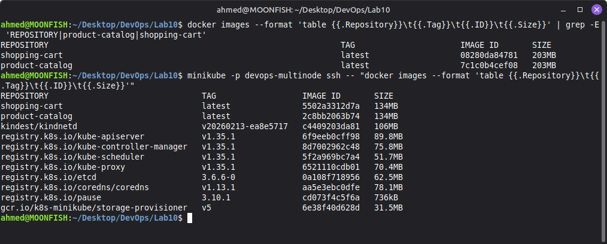
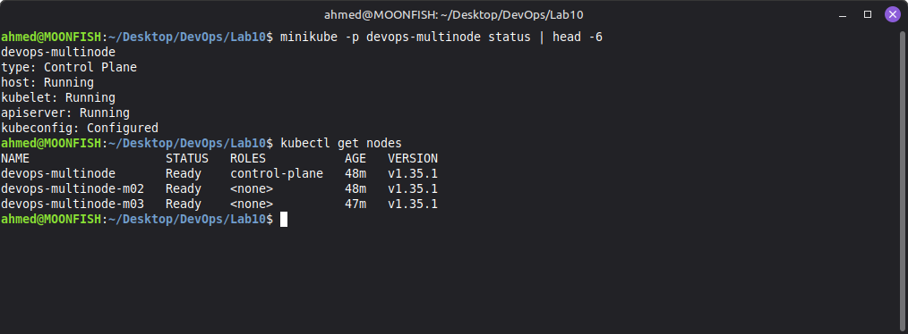
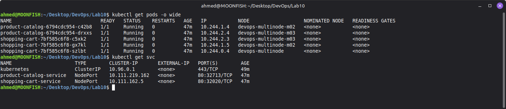
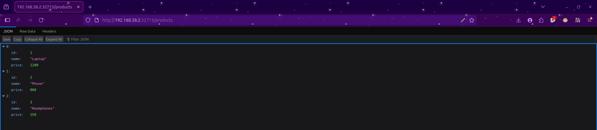
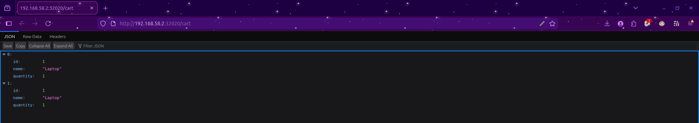
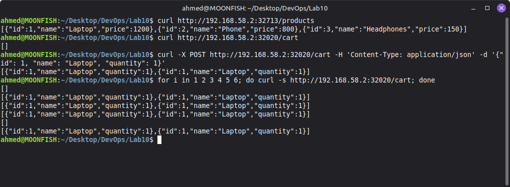

# Multi-Node Kubernetes Cluster with Multiple Applications and ReplicaSets

## Storyboard

An e-commerce platform with two services:

1. **Product Catalog** (AppA): lists available products, 2 replicas.
2. **Shopping Cart** (AppB): manages user carts, 3 replicas.

Each service's replicas are spread over different nodes (pod anti-affinity on `kubernetes.io/hostname`), so one node failing doesn't take a service down.

## Files

| File | Purpose |
|---|---|
| `product_catalog.py`, `shopping_cart.py` | Flask apps |
| `Dockerfile.product`, `Dockerfile.shopping` | Images |
| `product_catalog_deployment.yaml`, `shopping_cart_deployment.yaml` | Deployments (2 and 3 replicas, anti-affinity) |
| `product_catalog_service.yaml`, `shopping_cart_service.yaml` | NodePort services |
| `outputs/` | Raw captured output of every step below |

## Deviations from the exercise text

- **Step 0 skipped:** `minikube delete` would have wiped the existing default `minikube` profile. Only the `devops-multinode` profile was created and touched.
- **`--force` not used:** it is only needed when running as root. Added `--cpus=2 --memory=2200` per node to fit the host.
- **`kubectl`** is not installed on this machine, so `minikube -p devops-multinode kubectl --` was used in place of `kubectl`.
- **Namespace fix:** the exercise's `shopping_cart_deployment.yaml` uses `namespace: devops-exercise`, which does not exist and differs from the Service's namespace (`default`). It was changed to `default`.
- **Service access:** on this Linux/Docker setup `minikube service --url` returns the node IP and NodePort directly (no tunnel needed), so curl was run against those URLs.
- **Screenshots:** all images are live captures of real gnome-terminal and Firefox windows, taken after the deployment was running (so cluster ages read ~48m rather than the seconds shown in the earlier `outputs/` text). The `outputs/` text files are the raw output from the first run.

## Steps and output

### Step 3-4: Start the 3-node cluster

```
$ minikube start --nodes 3 -p devops-multinode --cpus=2 --memory=2200
* Enabled addons: storage-provisioner, default-storageclass

* Starting "devops-multinode-m02" worker node in "devops-multinode" cluster
* Pulling base image v0.0.50 ...
* Found network options:
  - NO_PROXY=192.168.58.2
  - env NO_PROXY=192.168.58.2
* Verifying Kubernetes components...

* Starting "devops-multinode-m03" worker node in "devops-multinode" cluster
* Pulling base image v0.0.50 ...
* Found network options:
  - NO_PROXY=192.168.58.2,192.168.58.3
  - env NO_PROXY=192.168.58.2
  - env NO_PROXY=192.168.58.2,192.168.58.3
* Verifying Kubernetes components...
* kubectl not found. If you need it, try: 'minikube kubectl -- get pods -A'
* Done! kubectl is now configured to use "devops-multinode" cluster and "default" namespace by default
```

### Cluster status

```
$ minikube -p devops-multinode status
devops-multinode
type: Control Plane
host: Running
kubelet: Running
apiserver: Running
kubeconfig: Configured

devops-multinode-m02
type: Worker
host: Running
kubelet: Running

devops-multinode-m03
type: Worker
host: Running
kubelet: Running
```

### Enable the registry add-on

```
$ minikube -p devops-multinode addons enable registry
* registry is an addon maintained by minikube. For any concerns contact minikube on GitHub.
You can view the list of minikube maintainers at: https://github.com/kubernetes/minikube/blob/master/OWNERS
  - Using image registry.k8s.io/minikube/kube-registry-proxy:v0.0.11
  - Using image docker.io/registry:3.0.0
* Verifying registry addon...
* The 'registry' addon is enabled
```

### Build images

```
$ docker build -t product-catalog:latest -f Dockerfile.product .
$ docker build -t shopping-cart:latest -f Dockerfile.shopping .
$ docker images --format 'table {{.Repository}}\t{{.Tag}}\t{{.ID}}\t{{.Size}}'   # filtered to the two app images
REPOSITORY                                                             TAG                      IMAGE ID       SIZE
shopping-cart                                                          latest                   08280da84781   203MB
product-catalog                                                        latest                   7c1c0b4cef08   203MB
```

### Load images into the cluster and verify on a node

```
$ minikube -p devops-multinode image load product-catalog:latest
$ minikube -p devops-multinode image load shopping-cart:latest
$ minikube -p devops-multinode ssh -- docker images --format 'table {{.Repository}}\t{{.Tag}}\t{{.ID}}\t{{.Size}}'
REPOSITORY                                TAG                  IMAGE ID       SIZE
shopping-cart                             latest               5502a3312d7a   134MB
product-catalog                           latest               2c8bb2063b74   134MB
kindest/kindnetd                          v20260213-ea8e5717   c4409203da81   106MB
registry.k8s.io/kube-apiserver            v1.35.1              6f9eeb0cff98   89.8MB
registry.k8s.io/kube-scheduler            v1.35.1              5f2a969bc7a4   51.7MB
registry.k8s.io/kube-controller-manager   v1.35.1              8d7002962c48   75.8MB
registry.k8s.io/kube-proxy                v1.35.1              6521110cdb01   70.4MB
registry.k8s.io/etcd                      3.6.6-0              0a108f718956   62.5MB
registry.k8s.io/coredns/coredns           v1.13.1              aa5e3ebc0dfe   78.1MB
registry.k8s.io/pause                     3.10.1               cd073f4c5f6a   736kB
gcr.io/k8s-minikube/storage-provisioner   v5                   6e38f40d628d   31.5MB
```



### Deploy

```
$ kubectl apply -f product_catalog_deployment.yaml -f shopping_cart_deployment.yaml -f product_catalog_service.yaml -f shopping_cart_service.yaml
deployment.apps/product-catalog created
deployment.apps/shopping-cart created
service/product-catalog-service created
service/shopping-cart-service created
```

### Nodes

```
$ kubectl get nodes
NAME                   STATUS   ROLES           AGE    VERSION
devops-multinode       Ready    control-plane   2m4s   v1.35.1
devops-multinode-m02   Ready    <none>          93s    v1.35.1
devops-multinode-m03   Ready    <none>          49s    v1.35.1
```



### Verify distribution: each app's pods are on different nodes

```
$ kubectl get pods -o wide
NAME                               READY   STATUS    RESTARTS   AGE   IP           NODE                   NOMINATED NODE   READINESS GATES
product-catalog-6794cdc954-c42b8   1/1     Running   0          3s    10.244.1.4   devops-multinode-m02   <none>           <none>
product-catalog-6794cdc954-drxxs   1/1     Running   0          3s    10.244.2.4   devops-multinode-m03   <none>           <none>
shopping-cart-7bf585c6f8-c5xk2     1/1     Running   0          3s    10.244.2.3   devops-multinode-m03   <none>           <none>
shopping-cart-7bf585c6f8-gx7kl     1/1     Running   0          3s    10.244.1.5   devops-multinode-m02   <none>           <none>
shopping-cart-7bf585c6f8-szlbt     1/1     Running   0          3s    10.244.0.4   devops-multinode       <none>           <none>
```

### Services

```
$ kubectl get svc
NAME                      TYPE        CLUSTER-IP       EXTERNAL-IP   PORT(S)        AGE
kubernetes                ClusterIP   10.96.0.1        <none>        443/TCP        2m3s
product-catalog-service   NodePort    10.111.219.162   <none>        80:32713/TCP   3s
shopping-cart-service     NodePort    10.111.162.5     <none>        80:32020/TCP   3s
```



### Access and test with curl

```
$ minikube -p devops-multinode service product-catalog-service --url
http://192.168.58.2:32713
$ minikube -p devops-multinode service shopping-cart-service --url
http://192.168.58.2:32020
```

```
$ curl http://192.168.58.2:32713/products
[{"id":1,"name":"Laptop","price":1200},{"id":2,"name":"Phone","price":800},{"id":3,"name":"Headphones","price":150}]

$ curl http://192.168.58.2:32020/cart
[]

$ curl -X POST http://192.168.58.2:32020/cart ...
[{"id":1,"name":"Laptop","quantity":1}]

$ curl http://192.168.58.2:32020/cart (x6, different replicas answer; cart is in-memory per pod)
[{"id":1,"name":"Laptop","quantity":1}]
[{"id":1,"name":"Laptop","quantity":1}]
[{"id":1,"name":"Laptop","quantity":1}]
[]
[{"id":1,"name":"Laptop","quantity":1}]
[]
```





**Note on the cart:** the cart lives in each pod's memory and the Service load-balances over 3 replicas, so after one POST only the pod that handled it holds the item. Repeated GETs alternate between `[]` and the item. That is expected for this exercise's design; sharing state across replicas would need an external store such as Redis or a database.

## Cleanup

```
minikube stop -p devops-multinode
minikube delete -p devops-multinode
```

## Summary

Two Flask apps were deployed to a 3-node minikube cluster with 2 and 3 replicas. Pod anti-affinity placed every replica of an app on a different node, and both services answered correctly through their NodePorts.
