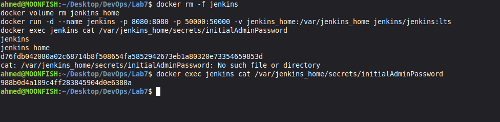
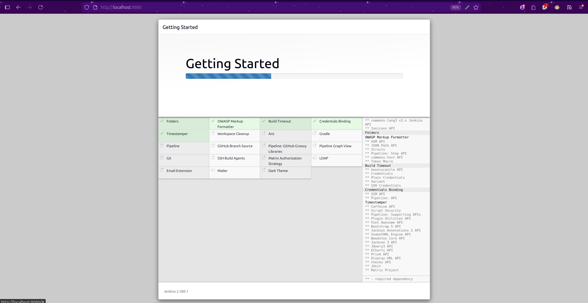
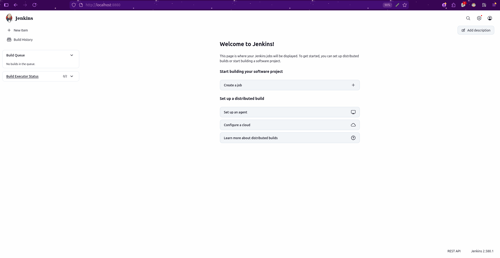

# Introduction to Continuous Integration (CI) and Jenkins Installation

## What is Continuous Integration (CI)?

Continuous Integration (CI) is a development practice where developers frequently integrate their code changes into a shared repository. The primary goal of CI is to detect and address errors early in the development process, improving software quality and accelerating delivery.

---

## Key Features of CI

1. **Frequent Code Integration**
   - Developers commit code to a shared repository multiple times a day.
2. **Automated Builds**
   - Every commit triggers an automated build to verify the code changes.
3. **Automated Testing**
   - Automated tests run as part of the CI process to ensure functionality remains intact.
4. **Immediate Feedback**
   - Developers receive quick feedback on their changes, allowing them to address issues promptly.

---

## Benefits of CI

- **Early Bug Detection:** CI helps identify integration issues early, reducing the cost of fixing bugs.
- **Improved Collaboration:** Developers work together on the same codebase, ensuring changes are integrated smoothly.
- **Faster Development Cycles:** Automated builds and tests speed up the development process.
- **High-Quality Code:** Continuous testing ensures code quality and prevents regressions.

---

## How CI Works

1. **Developer Workflow**
   - Developers write code and push changes to the version control system (e.g., Git).
2. **CI Server Workflow**
   - The CI server (e.g., Jenkins, GitLab CI) detects the code changes and triggers the build process.
3. **Automated Build**
   - The codebase is compiled, dependencies are resolved, and the application is built.
4. **Automated Testing**
   - Unit tests, integration tests, and other automated tests are run to verify functionality.
5. **Feedback**
   - Results (success/failure) are communicated back to the developers for further action.

---

## Example of CI Tools

### 1. GitLab CI/CD

- **Overview:** A part of GitLab's platform, GitLab CI/CD provides CI/CD capabilities integrated directly with Git repositories.
- **Key Features:**
  - Built-in with GitLab.
  - YAML-based pipeline definitions.
  - Auto DevOps for automated CI/CD pipelines.
- **Ideal For:** Teams using GitLab for version control.
- **Website:** [https://gitlab.com](https://gitlab.com)

### 2. CircleCI

- **Overview:** A cloud-based CI/CD tool known for its ease of integration with GitHub and Bitbucket.
- **Key Features:**
  - Container-based execution environments.
  - Parallelism and caching for faster builds.
  - Supports Docker natively.
- **Ideal For:** Teams with heavy use of containerized workflows.
- **Website:** [https://circleci.com](https://circleci.com)

### 3. Travis CI

- **Overview:** A CI service for open-source and private projects, particularly popular in the open-source community.
- **Key Features:**
  - YAML-based configurations.
  - Native support for many programming languages.
  - Easy integration with GitHub.
- **Ideal For:** Open-source projects and small teams.
- **Website:** [https://travis-ci.org](https://travis-ci.org)

### 4. Bamboo

- **Overview:** A CI/CD tool by Atlassian, designed to integrate seamlessly with JIRA and Bitbucket.
- **Key Features:**
  - Supports build and deployment pipelines.
  - Integration with Atlassian tools (e.g., JIRA, Confluence).
  - Prebuilt deployment environments.
- **Ideal For:** Teams already using Atlassian's ecosystem.
- **Website:** [https://www.atlassian.com/software/bamboo](https://www.atlassian.com/software/bamboo)

### 5. TeamCity

- **Overview:** A CI/CD server from JetBrains offering a wide range of integrations and advanced features.
- **Key Features:**
  - Detailed build history and reports.
  - Pre-built runners for multiple platforms and languages.
  - Plugins for Docker, Kubernetes, and more.
- **Ideal For:** Complex enterprise-level CI/CD setups.
- **Website:** [https://www.jetbrains.com/teamcity](https://www.jetbrains.com/teamcity)

### 6. Azure DevOps (Pipelines)

- **Overview:** A Microsoft product offering CI/CD pipelines as part of its DevOps suite.
- **Key Features:**
  - Integration with Azure and Visual Studio.
  - YAML or classic editor for pipeline definitions.
  - Multi-platform support (Windows, macOS, Linux).
- **Ideal For:** Teams using Azure cloud services.
- **Website:** [https://azure.microsoft.com/en-us/services/devops/](https://azure.microsoft.com/en-us/services/devops/)

### 7. GitHub Actions

- **Overview:** A CI/CD solution provided by GitHub for automating workflows directly from your repositories.
- **Key Features:**
  - YAML-based workflow definitions.
  - Extensive marketplace of pre-built actions.
  - Deep integration with GitHub repositories.
- **Ideal For:** Teams using GitHub for version control.
- **Website:** [https://github.com/features/actions](https://github.com/features/actions)

### 8. Spinnaker

- **Overview:** An open-source tool for continuous delivery and application management, primarily for cloud-native applications.
- **Key Features:**
  - Multi-cloud deployment support.
  - Integration with Kubernetes, AWS, GCP, and more.
  - Advanced deployment strategies (e.g., canary, blue-green).
- **Ideal For:** Teams focused on complex cloud-based deployments.
- **Website:** [https://spinnaker.io](https://spinnaker.io)

### 9. Buildkite

- **Overview:** A hybrid CI/CD platform that allows running pipelines on your infrastructure with scalability.
- **Key Features:**
  - Hybrid approach: cloud management + self-hosted agents.
  - Supports parallel builds and containerized workflows.
  - Native integration with many tools.
- **Ideal For:** Teams with security concerns about fully cloud-based solutions.
- **Website:** [https://buildkite.com](https://buildkite.com)

### 10. Drone

- **Overview:** A modern CI/CD platform that uses a lightweight, containerized approach to build pipelines.
- **Key Features:**
  - Uses Docker containers for pipeline steps.
  - Integrates with GitHub, GitLab, Bitbucket, and more.
  - Open-source and highly customizable.
- **Ideal For:** Teams preferring container-based workflows.
- **Website:** [https://www.drone.io](https://www.drone.io)

---

## CI Workflow Example

Here's a simple workflow for CI using a CI server:

1. **Code Change:** A developer pushes code to a Git repository.
2. **Trigger Build:** The CI server detects the push and triggers a build.
3. **Run Tests:** Automated tests validate the code.
4. **Feedback:** Developers get feedback about the build and test results.

---

# Introduction to Jenkins

## What is Jenkins?

Jenkins is an open-source automation server used to build, test, and deploy software. It helps automate parts of the software development process related to building, testing, and deploying, enabling Continuous Integration (CI) and Continuous Delivery (CD).

## Why Use Jenkins?

- **Automation:** Automates repetitive tasks.
- **Continuous Integration:** Ensures that code changes integrate smoothly.
- **Extensibility:** Supports plugins for various tools and services.
- **Scalability:** Can run distributed builds on multiple machines.

## Key Jenkins Concepts

1. **Job/Project:** A task or process that Jenkins runs.
2. **Build:** The process of compiling and packaging code.
3. **Pipeline:** A series of steps to build, test, and deploy your application.
4. **Plugins:** Extend Jenkins' functionality (e.g., Git plugin, Docker plugin).
5. **Nodes:** Machines where Jenkins runs jobs (Master/Agent setup).

---

## Getting Started with Jenkins

### 1. Install Jenkins using Docker

You can install Jenkins using Docker for simplicity:

```
docker run -d --name jenkins -p 8080:8080 -p 50000:50000 -v jenkins_home:/var/jenkins_home jenkins/jenkins:lts
```

> **Note:** External access is on port **8080**. Port `50000` is used by build agents. The `jenkins_home` volume keeps your Jenkins data if the container is recreated.

### 2. Get the Jenkins Initial Password

List the containers to confirm Jenkins is running:

```
docker ps -a
```

Example output:

```
CONTAINER ID   IMAGE                 COMMAND                  CREATED          STATUS          PORTS                                                                                      NAMES
d350facb3a26   jenkins/jenkins:lts   "/usr/bin/tini -- /u…"   14 minutes ago   Up 14 minutes   0.0.0.0:8080->8080/tcp, :::8080->8080/tcp, 0.0.0.0:50000->50000/tcp, :::50000->50000/tcp   jenkins
```

Print the initial admin password (replace `jenkins` with the container name or ID if yours is different):

```
docker exec jenkins cat /var/jenkins_home/secrets/initialAdminPassword
```

Example output (your password will be different):

```
060a3736329e4533ab8e4428ffcc9619
```

My terminal output:



> **Tip:** If the command prints `No such file or directory`, Jenkins is still starting. Wait about 30 seconds and run it again.

### 3. Access Jenkins on Port 8080

Open the following URL in your browser:

```
http://localhost:8080/
```

Paste the initial admin password into the **Unlock Jenkins** screen, then choose **Install suggested plugins**.

### 4. Installation Screens

Getting Started, plugins being installed:



Jenkins landing page after setup:



---

## Troubleshooting

| Symptom | Cause and fix |
|---|---|
| `container name "/jenkins" is already in use` | An old container has that name. Remove it with `docker rm -f jenkins`, or choose a different `--name`. |
| `port is already allocated` / `address already in use` on 8080 | Another container or service (for example Tomcat) uses the port. Free it, or map Jenkins to another host port such as `-p 8081:8080`. |
| `cat: ...initialAdminPassword: No such file or directory` | Jenkins is still starting. Wait about 30 seconds and retry. |
